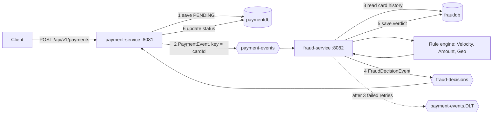

# Real-Time Payment Fraud Detection

Two Spring Boot microservices that decide, in real time, whether a card payment goes through. The payment service stores the payment and publishes an event to Kafka. The fraud service scores it against three rules and publishes a verdict. The payment service then sets the final status: `APPROVED`, `FLAGGED` or `BLOCKED`.

    

[](https://codespaces.new/rohantibile/payment-fraud-detection)

---

## Demo

> Demo GIF coming soon. Until then, the [quick start](#quick-start) below runs the full flow in about five minutes.

## The problem

Fraud checks must not slow the payment request down, and they must keep working when one service is down or a message is delivered twice. This project separates the two concerns with Kafka and makes both sides safe to retry.

## Architecture



Kafka (KRaft mode, no Zookeeper) and MySQL run in Docker Compose. The two services run on the host. Detailed diagrams and flows are in [`docs/`](docs/).

## Fraud rules

| Rule | Condition | Result |
|---|---|---|
| Velocity | 3 or more earlier payments from the same card in the last 60 seconds (the 4th rapid payment) | `BLOCKED` |
| Amount | Amount greater than 100000 (exactly 100000 is allowed) | `FLAGGED` |
| Geo mismatch | An earlier payment from a different city in the last 10 minutes (case-insensitive) | `BLOCKED` |

If several rules trigger, the most severe result wins (`BLOCKED` over `FLAGGED` over `APPROVED`) and every reason is listed. A new rule is one new class that implements `FraudRule`; the engine picks it up automatically.

## Key features

- **Strategy-pattern rule engine.** Rules are independent beans injected as a list, so adding one needs no change to existing code.
- **Per-card ordering.** Events use `cardId` as the Kafka key, so one card's payments are processed in order.
- **Idempotent processing.** The fraud service skips a payment it has already decided. The payment service only updates a payment that is still `PENDING`.
- **Manual offset commits** in the fraud service, acknowledged only after processing succeeds.
- **Retry and dead-letter topic.** A failing event is retried 3 times, 1 second apart, then moved to `payment-events.DLT` so it cannot block the partition.
- **Separate databases.** `paymentdb` and `frauddb`; the services share no code and communicate only through JSON messages.
- **12 unit tests** for the rules and the engine, which run without Kafka or a database.

## Tech stack

Java 17, Spring Boot 4.1.1, Spring Data JPA, Spring for Apache Kafka, Apache Kafka 3.8 (KRaft), MySQL 8.0, Docker Compose, Maven, JUnit 5.

## Quick start

Requirements: Docker with Compose, and Java 17. GitHub Codespaces has both.

```bash
git clone https://github.com/rohantibile/payment-fraud-detection.git
cd payment-fraud-detection

docker compose up -d          # Kafka, Kafka UI, MySQL
sleep 25                      # let MySQL finish starting

# terminal 1
cd fraud-service && ./mvnw spring-boot:run

# terminal 2
cd payment-service && ./mvnw spring-boot:run
```

Send a payment:

```bash
curl -s -X POST http://localhost:8081/api/v1/payments \
  -H "Content-Type: application/json" \
  -d '{"cardId":"CARD-1","amount":2500,"merchant":"Amazon","city":"Pune"}'
```

The response shows `"status":"PENDING"` and an `id`. A moment later:

```bash
curl http://localhost:8081/api/v1/payments/<id>      # status is now APPROVED
```

### Try each rule

```bash
pay() { curl -s -X POST http://localhost:8081/api/v1/payments -H "Content-Type: application/json" \
  -d "{\"cardId\":\"$1\",\"amount\":$2,\"merchant\":\"Test\",\"city\":\"$3\"}" > /dev/null; }

for i in 1 2 3 4; do pay CARD-V 100 Pune; done   # 4th payment is BLOCKED (velocity)
pay CARD-A 150000 Pune                           # FLAGGED (amount)
pay CARD-G 100 Pune; pay CARD-G 100 Mumbai       # second is BLOCKED (geo mismatch)
```

Watch the verdicts in the fraud-service log (`Decision BLOCKED for payment ...`) or read the final status with the `GET` call.

### Try the failure path

`fraud.simulate-failure` is `true` in `fraud-service/src/main/resources/application.yml`. A payment with merchant `SIMULATE_FAILURE` then fails on purpose, is retried 3 times, and lands in `payment-events.DLT`. Set it to `false` to turn the demo hook off.

## API

| Method | Path | Description |
|---|---|---|
| `POST` | `/api/v1/payments` | Create a payment. Body: `cardId`, `amount` (positive), `merchant`, `city`; all required and non-blank. Returns `201` with status `PENDING`. |
| `GET` | `/api/v1/payments/{id}` | Fetch a payment and its current status. `404` if unknown. |

## Tests

```bash
cd fraud-service && ./mvnw test -Dtest='*RuleTest,FraudEngineTest'    # 12 tests, no Kafka or DB needed
```

Step-by-step scenario documents with expected results are in the repository: `day1-infra-payment-crud-test.md` to `day4-decision-loop-test.md`.

## Project structure

```
payment-fraud-detection/
├── docker-compose.yml          Kafka (KRaft), Kafka UI, MySQL
├── docker/init.sql             creates paymentdb and frauddb
├── payment-service/            REST API, producer, decision consumer   (port 8081)
├── fraud-service/              consumer, rule engine, verdict producer (port 8082)
└── docs/                       architecture, workflows, code map, data flow, and more
```

## Documentation

| Document | Contents |
|---|---|
| [architecture.md](docs/architecture.md) | Components, startup order, dependencies |
| [workflows.md](docs/workflows.md) | Request flow, retry and dead-letter path, failure handling |
| [code-map.md](docs/code-map.md) | Every class and what it does |
| [data-flow.md](docs/data-flow.md) | Tables, topics, message formats, status lifecycle |
| [project-map.md](docs/project-map.md) | Repository layout and how to run |
| [verification-report.md](docs/verification-report.md) | What was checked against the code |

## Design decisions and known limitations

- **At-least-once delivery, made safe by idempotency.** Redelivered events produce the same result.
- **The payment is saved and the event published in two separate steps.** A crash between them would leave a `PENDING` payment with no event. The standard fix is a transactional outbox; it is not implemented.
- **No reprocessing of the dead-letter topic.** Failed events are parked for inspection.
- **Local demo settings.** Database credentials are in the `application.yml` files and must move to environment variables before any real deployment.

## Roadmap

- [ ] Demo GIF
- [ ] GitHub Actions build and test workflow
- [ ] Dockerfiles for both services and a one-command full stack
- [ ] Free hosted demo
- [ ] Transactional outbox

## Author

Rohan Tibile · [LinkedIn](https://www.linkedin.com/in/rohantibile) · [Portfolio](https://rohantibile.github.io)
