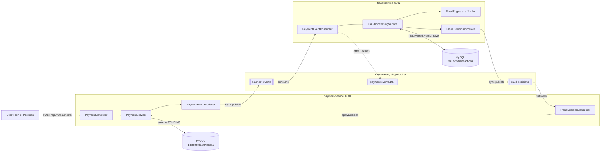
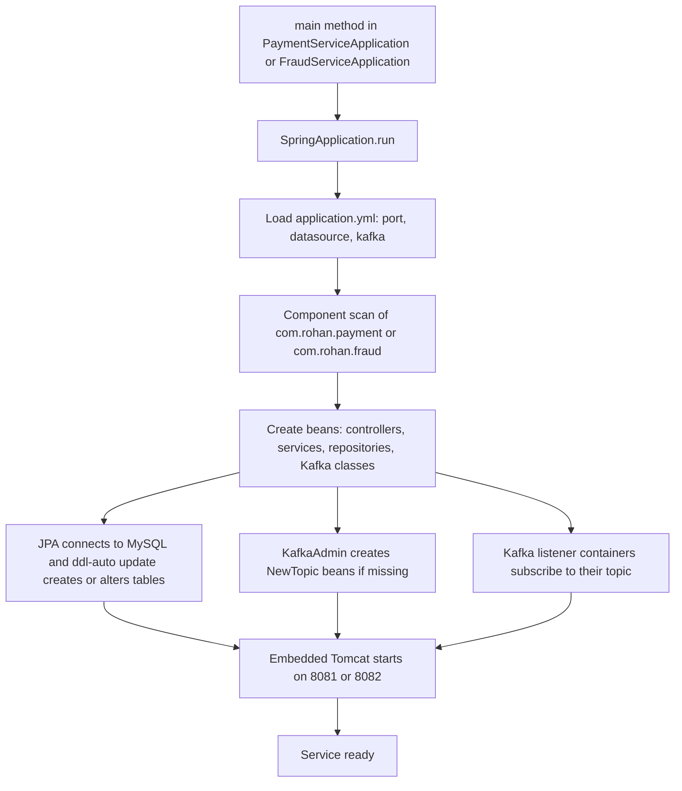
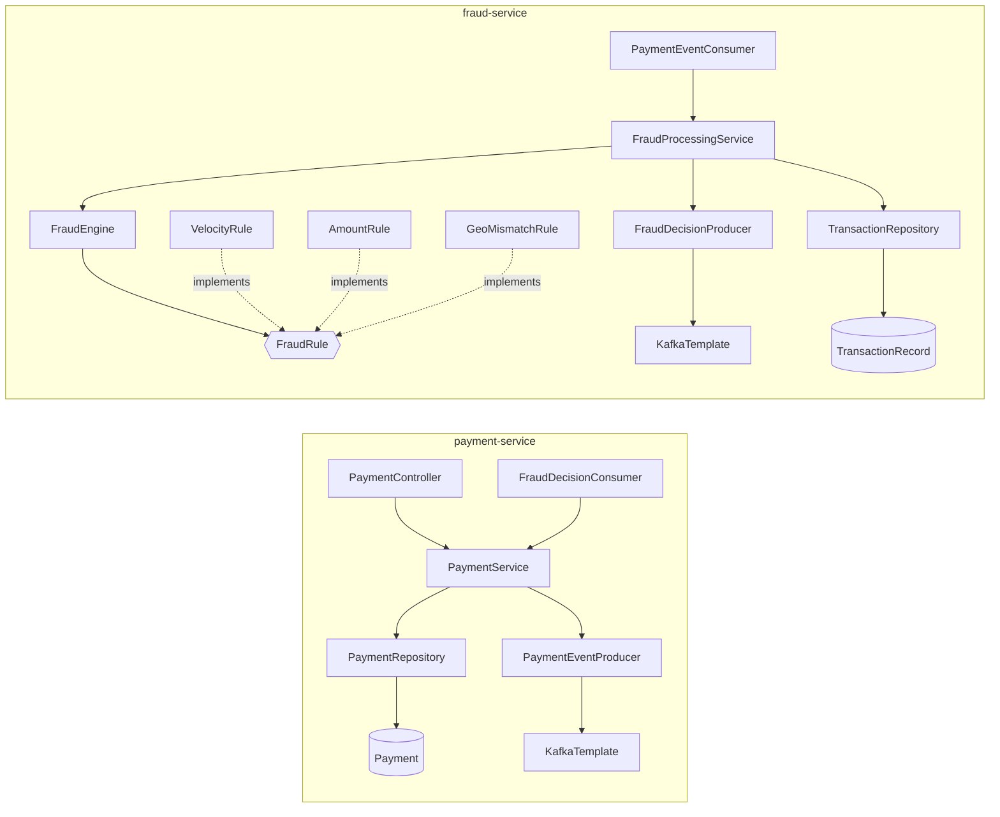
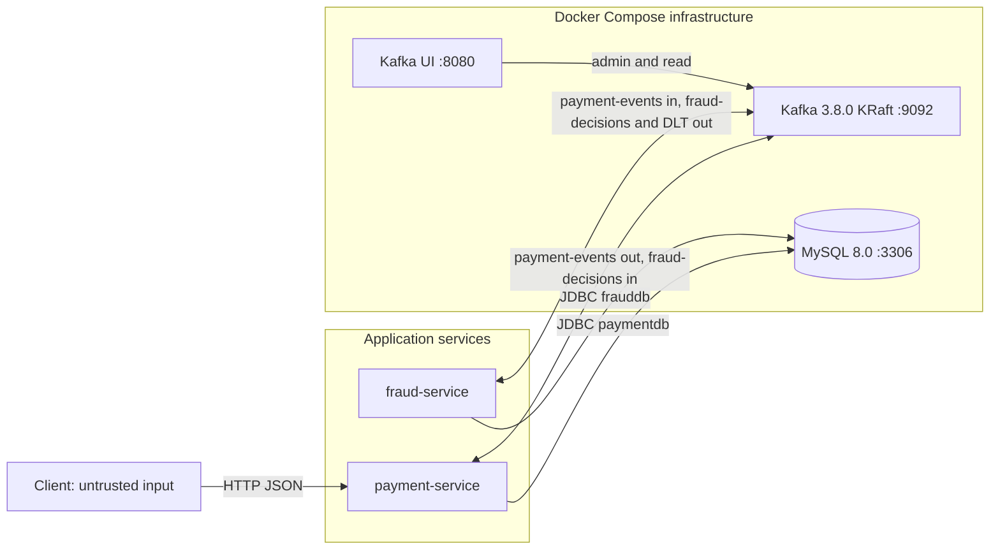

# System Architecture

Event-driven payment fraud detection. A client submits a payment, a second service decides whether it is fraudulent, and the verdict flows back to update the payment.

Source of truth: the repository zip read on 2026-11-03 (Spring Boot 4.1.1, Java 17). Nothing here was run by the author of this document; see [Verification status](#verification-status).

**Evidence tags used below:** `[V]` read in source code, `[I]` inferred from framework behavior, `[U]` unverified or unknown, `[T]` a test exists in source.

Path shorthand: `PS` = `payment-service/src/main/java/com/rohan/payment`, `FS` = `fraud-service/src/main/java/com/rohan/fraud`.

## 1. What the system does

| Question | Answer |
|---|---|
| What does it do? | Accepts a payment over REST, stores it as `PENDING`, asks a fraud service to judge it over Kafka, then stores the verdict (`APPROVED`, `FLAGGED` or `BLOCKED`) on the payment. |
| What problem does it solve? | Detects suspicious card behavior in near real time without the payment API waiting for the fraud check. |
| Who or what interacts with it? | A client calling `POST /api/v1/payments` (curl or Postman). Operators watching topics in Kafka UI. No other actors `[V]`. |
| Fraud signals | Velocity (4th payment in 60 s), Amount (over 100000), Geo mismatch (different city within 10 min) `[V]`. |
| External services | None. Only Kafka and MySQL from Docker Compose `[V]`. |
| Not present | Authentication, caching, scheduled jobs, third-party APIs, service Dockerfiles, CI workflow `[V]`. |

## 2. Diagram A: high-level architecture

Question answered: which components exist and how do they talk?



Reading the arrows: solid arrows are the normal path; the dotted arrow is the failure path. Publishing to `payment-events` is fire and forget, publishing to `fraud-decisions` waits for the broker (up to 10 s). Both facts are in `PS/kafka/PaymentEventProducer.java` and `FS/kafka/FraudDecisionProducer.java` `[V]`. The dead-letter path is set up in `FS/config/KafkaErrorHandlingConfig.java` `[V]`; that Spring applies it to the listener automatically is `[I]`.

## 3. Diagram B: application startup

Question answered: what happens between launching a service and it being ready?



Differences between the two services `[V]` unless tagged:

| Step | payment-service | fraud-service |
|---|---|---|
| Port | 8081 | 8082 (Tomcat starts although the service exposes no endpoint, because `spring-boot-starter-webmvc` is in its `pom.xml`) |
| Database | `paymentdb`, table `payments` | `frauddb`, table `transactions` |
| Topics created | `payment-events`, `fraud-decisions` | `fraud-decisions`, `payment-events.DLT` |
| Listener subscribes to | `fraud-decisions`, group `payment-service-group` | `payment-events`, group `fraud-service-group` |
| Special beans | none | `FraudEngine` receives every `FraudRule` bean (3), `DefaultErrorHandler` bean |

The exact order of JPA, topic creation and listener start is `[I]`; only the set of steps is verified.

## 4. Diagram C: component dependencies

Question answered: which class depends on which?



Arrows mean "uses" (constructor injection `[V]`). The two services share no code; each keeps its own copy of the event records (`PaymentEvent` and `FraudDecisionEvent` exist in both `dto` packages) `[V]`. The contract between them is JSON field names only.

## 5. Directory and file map

```
payment-fraud-detection/
├── docker-compose.yml                 Kafka (KRaft), Kafka UI, MySQL
├── docker/init.sql                    creates paymentdb and frauddb
├── README.md, day*-test.md            project page and per-day test documents
├── payment-service/                   REST API, owns payment status
│   ├── pom.xml, mvnw
│   └── src/main/java/com/rohan/payment/
│       ├── controller/                PaymentController
│       ├── service/                   PaymentService (create, get, applyDecision)
│       ├── entity/                    Payment, PaymentStatus
│       ├── repository/                PaymentRepository
│       ├── dto/                       PaymentRequest, PaymentResponse, PaymentEvent, FraudDecisionEvent
│       ├── kafka/                     PaymentEventProducer, FraudDecisionConsumer
│       └── config/                    KafkaTopicConfig
└── fraud-service/                     fraud decisions, owns card history
    ├── pom.xml, mvnw
    └── src/main/java/com/rohan/fraud/
        ├── kafka/                     PaymentEventConsumer, FraudDecisionProducer
        ├── service/                   FraudProcessingService (orchestration)
        ├── engine/                    FraudEngine, FraudVerdict
        ├── rules/                     FraudRule, RuleResult, Velocity, Amount, GeoMismatch
        ├── model/                     TransactionRecord, Decision
        ├── repository/                TransactionRepository
        ├── dto/                       PaymentEvent, FraudDecisionEvent
        └── config/                    KafkaTopicConfig, KafkaErrorHandlingConfig
```

Files you will touch most: `PS/service/PaymentService.java`, `FS/service/FraudProcessingService.java`, `FS/engine/FraudEngine.java`, the three rule classes, and both `application.yml` files.

## 6. Diagram D: external integrations and trust boundary

Question answered: what does the system connect to, and where does untrusted input enter?



- The only untrusted input is the `POST` body, validated by `PaymentRequest` annotations `[V]`. Kafka messages are treated as trusted by both consumers `[V]`.
- Both databases live on one MySQL server as separate schemas, with the same `root` credentials in both `application.yml` files `[V]`. Fine for a demo, not for production.
- Kafka UI is a read-only convenience and is not part of the data path `[V]`.

## 7. Components

### C1. Payment API
- **Purpose:** accept and validate payments, return the stored result.
- **Files:** `PS/controller/PaymentController.java`, `PS/service/PaymentService.java`, `PS/dto/PaymentRequest.java`, `PS/dto/PaymentResponse.java`.
- **Key symbols:** `PaymentController.create`, `PaymentController.get`, `PaymentService.create`, `PaymentService.get`.
- **Input / output:** JSON `{cardId, amount, merchant, city}` in; `201` with `PaymentResponse` out `[V]`.
- **Depends on:** `PaymentRepository`, `PaymentEventProducer`.
- **State owned:** none (stateless).
- **Failure:** invalid body returns `400` `[I]`. `GET` by id is currently not mapped: `get` is annotated `@GetMapping` without `"/{id}"` `[V]`, so the fix is pending (see Verification status).
- **Tests:** none for the controller or `create`. `[V]`

### C2. Payment persistence
- **Purpose:** store payments and their status.
- **Files:** `PS/entity/Payment.java`, `PS/entity/PaymentStatus.java`, `PS/repository/PaymentRepository.java`.
- **State owned:** table `payments` in `paymentdb`. Lifecycle: `PENDING` then one of `APPROVED`, `FLAGGED`, `BLOCKED` `[V]`.
- **Failure:** a database outage makes `create` fail before anything is published `[I]`.

### C3. Payment event publisher
- **Purpose:** announce each new payment to Kafka.
- **Files:** `PS/kafka/PaymentEventProducer.java`, `PS/config/KafkaTopicConfig.java`.
- **Key symbol:** `PaymentEventProducer.publish` sends to `payment-events` with key `cardId` `[V]` (same card, same partition, ordered).
- **Pattern:** asynchronous. A failure reported through the send future is only logged (`whenComplete`). There is no try/catch around `send`, so an exception thrown synchronously by `send` would reach the caller and fail the `POST` `[V]`.
- **Failure:** the payment is saved first and published second, in two separate steps `[V]`. If publishing fails, the payment can stay `PENDING` with no event. The standard fix is the transactional outbox pattern.

### C4. Decision consumer
- **Purpose:** apply the fraud verdict to the payment.
- **Files:** `PS/kafka/FraudDecisionConsumer.java`, `PS/service/PaymentService.java` (`applyDecision`).
- **Key symbols:** `FraudDecisionConsumer.onDecision`, `PaymentService.applyDecision` (`@Transactional`).
- **Idempotency:** only a `PENDING` payment changes; a repeated or conflicting decision is ignored `[V]`.
- **Failure:** unknown payment id is logged and skipped. A decision string that is not a `PaymentStatus` name would throw in `valueOf`, and this service has no custom error handler `[V]`. What happens next is `[U]` (traced in Phase 4).
- **Tests:** `PaymentServiceDecisionTest` (2 tests) `[T]`.

### C5. Fraud intake and orchestration
- **Purpose:** receive a payment event and run the full fraud procedure.
- **Files:** `FS/kafka/PaymentEventConsumer.java`, `FS/service/FraudProcessingService.java`.
- **Key symbols:** `PaymentEventConsumer.onPayment`, `FraudProcessingService.process`.
- **Steps in `process`** `[V]`: skip if `paymentId` already stored (idempotency), optional simulated failure, load the card's last 10 minutes, evaluate, publish verdict, then save the record.
- **Ack:** manual. The offset is committed only after `process` returns `[V]`.
- **Failure:** an exception triggers retries then the dead-letter topic (C9). Because the verdict is published before the save, a retry after a failed save can publish the verdict twice, which C4 ignores `[V]`.

### C6. Rule engine
- **Purpose:** turn a payment plus card history into one verdict.
- **Files:** `FS/engine/FraudEngine.java`, `FS/engine/FraudVerdict.java`, `FS/rules/*.java`.
- **Key symbols:** `FraudEngine.evaluate`, `FraudRule.evaluate`, `VelocityRule`, `AmountRule`, `GeoMismatchRule`.
- **Behavior** `[V]`: every rule runs; the most severe result wins (`BLOCKED` over `FLAGGED` over `APPROVED`); all triggered reasons are joined into one string.
- **State owned:** none. Rules are pure functions of their inputs.
- **Tests:** 12 unit tests: `VelocityRuleTest` 3, `AmountRuleTest` 2, `GeoMismatchRuleTest` 4, `FraudEngineTest` 3 `[T]`.

### C7. Fraud persistence
- **Purpose:** remember each judged payment so later payments can be compared.
- **Files:** `FS/model/TransactionRecord.java`, `FS/model/Decision.java`, `FS/repository/TransactionRepository.java`.
- **Key symbols:** `findByCardIdAndCreatedAtGreaterThanEqual`, `existsById`.
- **State owned:** table `transactions` in `frauddb`; primary key `paymentId` (this is what makes the duplicate check work) `[V]`.
- **Open point:** the index `idx_card_created` is declared with Java field names, so whether MySQL created it is `[U]`.

### C8. Decision publisher
- **Purpose:** send the verdict back.
- **Files:** `FS/kafka/FraudDecisionProducer.java`, `FS/config/KafkaTopicConfig.java`.
- **Pattern:** synchronous with a 10 s wait, and it throws on failure, so the retry path engages `[V]`.

### C9. Kafka configuration and error handling
- **Files:** `FS/config/KafkaErrorHandlingConfig.java`, both `application.yml` files, `docker-compose.yml`.
- **Settings** `[V]`: fraud consumer `enable-auto-commit: false`, listener `ack-mode: manual_immediate`; error handler is 3 retries, 1 s apart (4 attempts total), then `payment-events.DLT`; JSON via `JacksonJsonSerializer` and `JacksonJsonDeserializer` with type headers off.
- **Failure:** the dead-letter topic is written but nothing reads it `[V]`.

## 8. Quality notes and known limits

- Diagrams show only components found in the source. No component was assumed.
- The save-then-publish gap (C3) is the main reliability risk.
- `fraud.simulate-failure: true` is still set in `fraud-service/src/main/resources/application.yml` in the zip read `[V]`. It only affects payments whose merchant is `SIMULATE_FAILURE`.

## Verification status

| Claim type | Status |
|---|---|
| Component list, file paths, class and method names, topic names, ports, dependencies | Read from source in the zip `[V]` |
| Spring behavior (automatic error handler, topic creation, startup order, validation `400`) | Inferred `[I]` |
| Runtime results | Not executed by the author of this document. Day 1 to 3 results and "Day 4 done" were reported by the project owner |
| `GET /api/v1/payments/{id}` | Defect in the zip read (missing `"/{id}"`); owner is applying the fix. Re-verify in Phase 7 |
| Index `idx_card_created` exists | Unknown `[U]` |

Next documents: [workflows](workflows.md), [code map](code-map.md), [data flow](data-flow.md).
