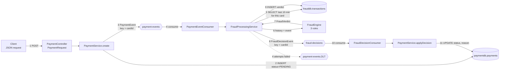
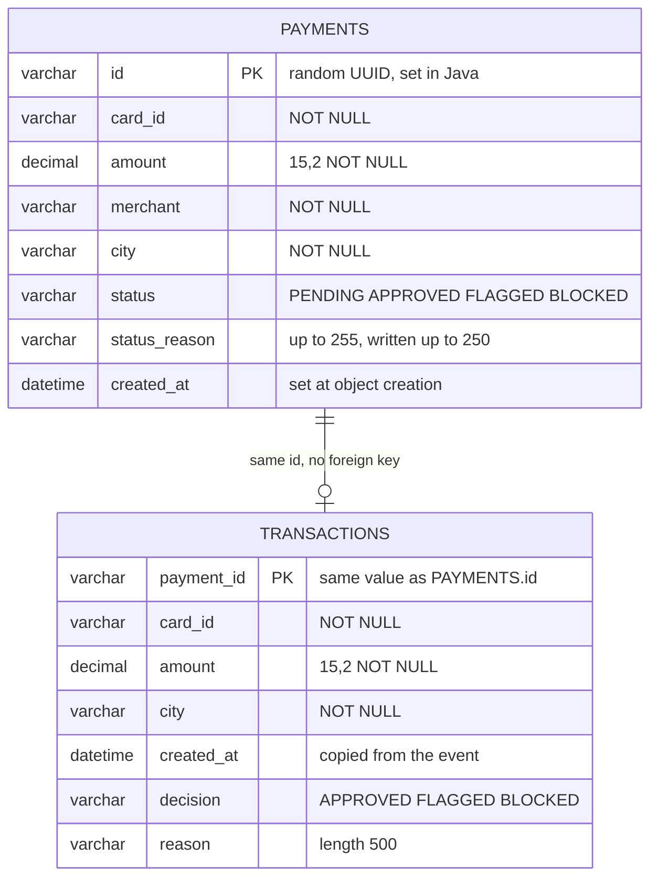
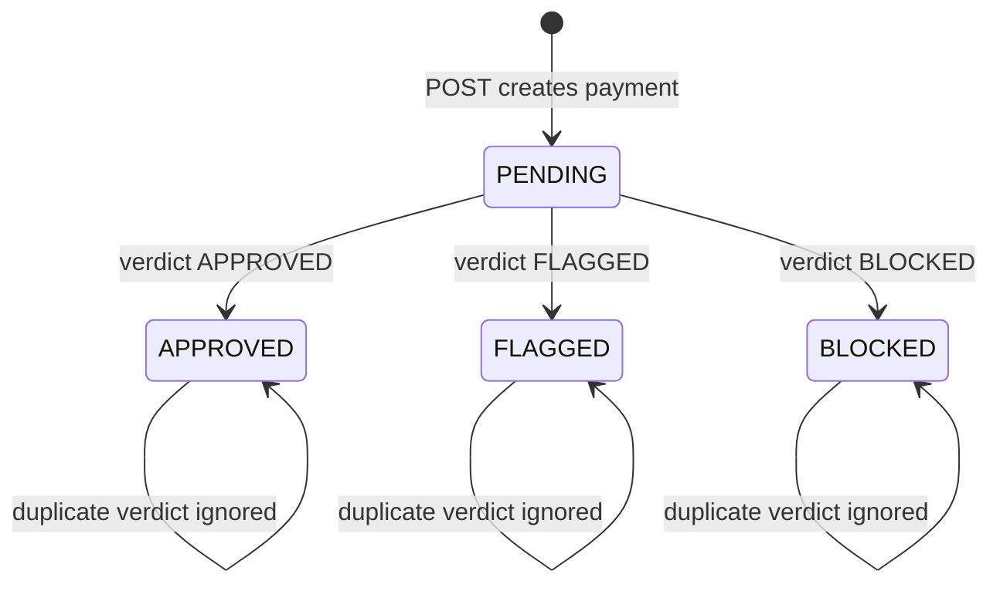

# Data Flow

How data enters, changes shape, is stored and leaves the system. Source: the repo zip (after the Day 4 merge), plus both `application.yml` files and `docker/init.sql`.

Evidence tags: **[V]** read in source/config. **[I]** inferred from framework behavior. **[U]** unverified, needs a run.

---

## 1. Data stores and channels

| Store / channel | Type | Owner | Content |
|---|---|---|---|
| `paymentdb.payments` | MySQL table | payment-service | One row per payment, with its current status |
| `frauddb.transactions` | MySQL table | fraud-service | One row per evaluated payment, with the verdict |
| `payment-events` | Kafka topic, 3 partitions | written by payment-service, read by fraud-service | A new payment |
| `fraud-decisions` | Kafka topic, 3 partitions | written by fraud-service, read by payment-service | A verdict |
| `payment-events.DLT` | Kafka topic, 3 partitions | written by fraud-service | Payments that failed 4 attempts |

Both databases live in one MySQL 8.0 container (`init.sql` creates `paymentdb` and `frauddb`). The tables are created by Hibernate (`ddl-auto: update`) at app startup; there is no schema script or migration tool. **[V]** Each service only touches its own database. **[V]**

---

## 2. End-to-end data flow



Numbers 1 to 11 are the order in which data moves. The dotted line is the failure path only.

**What changes shape along the way**

| Step | Shape | Notes |
|---|---|---|
| 1 | `PaymentRequest {cardId, amount, merchant, city}` | Validated with `@Valid`. **[V]** |
| 2 | `Payment` entity | Adds `id` (random UUID), `status=PENDING`, `createdAt=now`. **[V]** |
| 3 | `PaymentEvent {paymentId, cardId, amount, merchant, city, createdAt}` | Built by `PaymentEvent.from(payment)`. **[V]** |
| 5 | `List<TransactionRecord>` | Only payments that already have a stored verdict. **[V]** |
| 7 | `FraudVerdict {decision, reason}` | One verdict per payment, worst rule wins. **[V]** |
| 8 | `FraudDecisionEvent {paymentId, cardId, decision, reason, decidedAt}` | `decidedAt = Instant.now()` at publish time. **[V]** |
| 9 | `TransactionRecord` | id is the paymentId. **[V]** |
| 11 | `Payment.status` and `statusReason` | Reason cut to 250 characters. **[V]** |

---

## 3. Database schema



- The link between the tables is a shared value, not a foreign key: they are in different databases. **[V]**
- Column names above are the **default Spring Boot snake_case naming**. `[I]` Your Day 1 query `SELECT id, card_id, amount, status FROM paymentdb.payments` confirmed `card_id` for payments. For `transactions`, `card_id` and `created_at` are inferred.
- `transactions.created_at` is the **payment's** creation time (copied from the event), not the time of evaluation. **[V]** The rules compare against this value.
- `transactions` has no `merchant` column; fraud-service does not store the merchant. **[V]**
- `statusReason` has no `@Column(length)`, so `[I]` the default is `varchar(255)`. The code truncates to 250, which is why 500 characters of reason would otherwise fail on `payments`.
- Index `idx_card_created` on `transactions`: declared, not confirmed to exist. **[U]**

---

## 4. Kafka message contracts

| | `payment-events` | `fraud-decisions` | `payment-events.DLT` |
|---|---|---|---|
| Key | `cardId` (String) | `cardId` (String) | key of the original record `[I]` |
| Value | JSON `PaymentEvent` | JSON `FraudDecisionEvent` | the original payment JSON `[I]` |
| Producer | payment-service, `acks=all`, async | fraud-service, `acks=all`, blocks up to 10 s | `DeadLetterPublishingRecoverer` in fraud-service |
| Consumer | fraud-service, group `fraud-service-group` | payment-service, group `payment-service-group` | nobody (inspect manually) |
| Partitions | 3 | 3 | 3 |

**Example `payment-events` message** (illustrative values, field names from `PaymentEvent`) **[V]**
```json
{
  "paymentId": "13cf0117-b264-4e36-8260-47a5e87ee352",
  "cardId": "CARD-1001",
  "amount": 2500.50,
  "merchant": "Amazon",
  "city": "Pune",
  "createdAt": "2026-11-06T08:30:00.123Z"
}
```

**Example `fraud-decisions` message** **[V]**
```json
{
  "paymentId": "13cf0117-b264-4e36-8260-47a5e87ee352",
  "cardId": "CARD-1001",
  "decision": "BLOCKED",
  "reason": "VELOCITY: 3 payments in the last 60 seconds",
  "decidedAt": "2026-11-06T08:30:01.456Z"
}
```

**Serialization rules (both services)** **[V]**
- Key: `StringSerializer` / `StringDeserializer`.
- Value: `JacksonJsonSerializer` / `JacksonJsonDeserializer` (Spring Boot 4, Jackson 3).
- `spring.json.add.type.headers: false` on producers and `spring.json.use.type.headers: false` on consumers. No Java class names travel in headers, so the services stay independent. Each consumer decodes into its own fixed type via `spring.json.value.default.type`.
- Trusted packages: `com.rohan.fraud.dto` and `com.rohan.payment.dto` respectively.
- `auto-offset-reset: earliest` on both consumers: a brand new group reads from the start of the topic.

**Why `cardId` is the key:** the default partitioner hashes the key, so every event of one card lands in the same partition. Kafka orders messages within a partition, so one card's payments are processed in order. That ordering is what makes the velocity and geo rules reliable. **[V]** (key) / **[I]** (ordering guarantee)

Caveat: ordering holds only while the partition count does not change and while a record is not retried out of line. **[I]**

---

## 5. Payment status lifecycle



- Only PENDING can change; every other state is final. **[V]** (`applyDecision`)
- A payment can stay PENDING forever in three cases: the app dies between save and publish; the event ends in the DLT; fraud-service is down and the backlog is not yet consumed (this last one is temporary). **[V]/[I]**
- There is no timeout, no reprocessing job and no endpoint to move a DLT message back. **[V]**

---

## 6. Where each field is decided

| Field | Created by | Read by |
|---|---|---|
| `Payment.id` | `Payment` field initializer (UUID) | everything; becomes `paymentId` in events and the `transactions` primary key |
| `createdAt` | `Payment` field initializer | all time-window rules via the event |
| `status` | `Payment` (PENDING), then `applyDecision` | `GET` response |
| `decision`, `reason` | `FraudEngine` | `fraud-decisions` message, `transactions` row, then `payments.status_reason` |
| `cardId` | the client | Kafka key, history query, every rule |
| `city` | the client | `GeoMismatchRule` |
| `amount` | the client | `AmountRule` |
| `merchant` | the client | only the `SIMULATE_FAILURE` demo hook; not used by any rule |

---

## 7. Consistency and delivery guarantees

| Concern | What the code does | Evidence |
|---|---|---|
| Save and publish (payment-service) | Two separate steps, no outbox. A crash between them loses the event | **[V]** |
| Producer failure (payment-service) | A failure reported by the send future is only logged and the client still gets 201. An exception thrown synchronously by `send` (for example when Kafka is unreachable) is not caught and fails the POST after the row is saved; this matches the Day 2 `500` you saw | **[V]** / **[I]** |
| Delivery to fraud-service | At least once: manual ack after success, retried on error | **[V]** |
| Duplicate payment event | Skipped with `existsById` | **[V]** |
| Delivery to payment-service | At least once. Commit mode not set in config | **[V]** / **[U]** |
| Duplicate verdict | Ignored when status is not PENDING | **[V]** **[T]** |
| Publish vs save (fraud-service) | Publish first, then save; the retry is safe because of the two idempotency checks | **[V]** |
| Two events racing on one `paymentId` | Not handled (`existsById` is not atomic). Kafka's per-card ordering makes this unlikely | **[I]** |
| Failed event | 3 retries 1 s apart, then `payment-events.DLT`, consumer continues | **[V]** |

In short: the system is at-least-once with idempotent consumers, which gives effectively-once results on the paths tested in Day 4. The one real hole is the first row.

---

## 8. Data you can inspect

```bash
# Payments and their final status
docker exec -it $(docker compose ps -q mysql) mysql -uroot -proot -e \
 "SELECT id, card_id, status, status_reason FROM paymentdb.payments ORDER BY created_at DESC LIMIT 10;"

# Fraud verdicts
docker exec -it $(docker compose ps -q mysql) mysql -uroot -proot -e \
 "SELECT payment_id, card_id, city, amount, decision, reason FROM frauddb.transactions ORDER BY created_at DESC LIMIT 10;"

# Check that the index exists
docker exec -it $(docker compose ps -q mysql) mysql -uroot -proot -e "SHOW INDEX FROM frauddb.transactions;"
```

If a column name errors, run `DESCRIBE frauddb.transactions;` and tell me; the snake_case names for `transactions` are inferred, not seen. **[U]**

---

## 9. Open items

1. Column names and the index in `frauddb.transactions`: confirm with the queries above.
2. DLT message key and value format: confirm by consuming `payment-events.DLT` once (Day 4 test). **[U]**
3. Payment-service offset commit mode: `enable.auto.commit` in the startup log. **[U]**
4. `statusReason` column width: `DESCRIBE paymentdb.payments;` **[U]**
