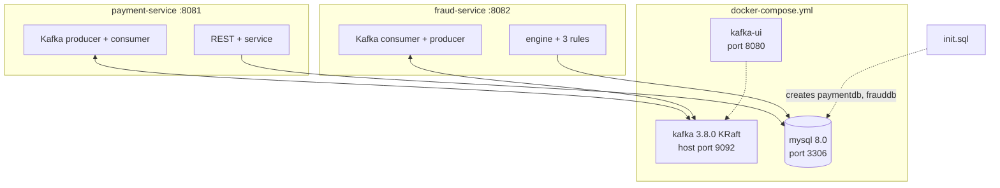

# Project Map

One-page orientation: what is in the repo, how it builds and runs, what depends on what, and where to look for anything. Source: the repo zip (after the Day 4 merge).

Evidence tags: **[V]** read in the repo. **[I]** inferred. **[U]** unverified.

---

## 1. What this project is

A Spring Boot system with two services that cooperate through Kafka. **payment-service** accepts a payment and stores it as `PENDING`. **fraud-service** checks it against three rules and sends back a verdict. payment-service then sets the final status to `APPROVED`, `FLAGGED` or `BLOCKED`. **[V]**

---

## 2. Repository tree (as it is today)

```
payment-fraud-detection/
├── README.md                        outline with placeholder text (Day 5 to finish)
├── docker-compose.yml               kafka (KRaft), kafka-ui, mysql
├── docker/
│   └── init.sql                     creates paymentdb and frauddb
├── day1-infra-payment-crud-test.md  test docs, currently in the repo root
├── day2-kafka-producer-consumer-test.md
├── day3-fraud-rules-test.md         final version (12 tests)
├── day4-decision-loop-test.md
├── payment-service/                 port 8081
│   ├── pom.xml
│   ├── mvnw, mvnw.cmd, .mvn/        Maven wrapper (no local Maven needed)
│   └── src/
│       ├── main/java/com/rohan/payment/
│       │   ├── PaymentServiceApplication.java
│       │   ├── controller/PaymentController.java
│       │   ├── service/PaymentService.java
│       │   ├── entity/{Payment, PaymentStatus}.java
│       │   ├── repository/PaymentRepository.java
│       │   ├── dto/{PaymentRequest, PaymentResponse, PaymentEvent, FraudDecisionEvent}.java
│       │   ├── kafka/{PaymentEventProducer, FraudDecisionConsumer}.java
│       │   └── config/KafkaTopicConfig.java
│       ├── main/resources/application.yml
│       └── test/java/com/rohan/payment/{PaymentServiceApplicationTests, PaymentServiceDecisionTest}.java
└── fraud-service/                   port 8082
    ├── pom.xml
    ├── mvnw, mvnw.cmd, .mvn/
    └── src/
        ├── main/java/com/rohan/fraud/
        │   ├── FraudServiceApplication.java
        │   ├── kafka/{PaymentEventConsumer, FraudDecisionProducer}.java
        │   ├── service/FraudProcessingService.java
        │   ├── engine/{FraudEngine, FraudVerdict}.java
        │   ├── rules/{FraudRule, RuleResult, VelocityRule, AmountRule, GeoMismatchRule}.java
        │   ├── model/{TransactionRecord, Decision}.java
        │   ├── repository/TransactionRepository.java
        │   ├── dto/{PaymentEvent, FraudDecisionEvent}.java
        │   └── config/{KafkaTopicConfig, KafkaErrorHandlingConfig}.java
        ├── main/resources/application.yml
        └── test/java/com/rohan/fraud/
            ├── FraudServiceApplicationTests.java, TestData.java
            ├── engine/FraudEngineTest.java
            └── rules/{VelocityRuleTest, AmountRuleTest, GeoMismatchRuleTest}.java
```
**[V]** (listing taken from the archive: 39 Java files, 31 main and 8 test, 890 lines in total).

**Not in the repo yet:** CI workflow (`.github/workflows`), `.devcontainer/`, `Dockerfile` for either service, a demo GIF, a `docs/` folder, a LICENSE. **[V]**

---

## 3. How the pieces connect



The services run on the host (via `./mvnw spring-boot:run`), not in containers. Only Kafka, Kafka UI and MySQL are containers. Both services connect to `localhost:9092` and `localhost:3306`. **[V]**

---

## 4. Build and technology

| Item | Value | Source |
|---|---|---|
| Language | Java 17 | `<java.version>` in both poms **[V]** |
| Framework | Spring Boot 4.1.1 (parent pom) | **[V]** |
| Build | Maven via the wrapper `./mvnw` | **[V]** |
| Starters | data-jpa, kafka, validation, webmvc | both poms **[V]** |
| Database driver | `mysql-connector-j` (runtime) | **[V]** |
| Test starters | data-jpa-test, kafka-test, validation-test, webmvc-test | both poms **[V]** |
| Not used | Lombok, springdoc/Swagger, Flyway/Liquibase, Spring Security, Actuator | none found in the poms **[V]** |

Notes:
- fraud-service includes `webmvc`, so it starts Tomcat on 8082 even though it has no controller. **[V]** `[I]` This is harmless; it only costs a port.
- The Day 1 test doc mentions Swagger UI, but springdoc was removed on Day 2. That line in `day1-infra-payment-crud-test.md` is out of date. **[V]**
- The two poms are independent (no parent pom, no multi-module build). Each service builds alone. **[V]**

---

## 4a. Ports and credentials

| What | Value | Where |
|---|---|---|
| payment-service | 8081 | its `application.yml` |
| fraud-service | 8082 | its `application.yml` |
| Kafka (from the host) | `localhost:9092` | `docker-compose.yml`, both yml files |
| Kafka UI | 8080 | `docker-compose.yml` |
| MySQL | 3306, user `root`, password `root` | `docker-compose.yml` and both yml files |

The MySQL root password is hardcoded in the committed yml files. That is acceptable for a local demo and unacceptable anywhere else. If you deploy this, move credentials to environment variables first. **[V]**

---

## 5. Run it

```bash
docker compose up -d                  # kafka, kafka-ui, mysql
sleep 25                              # let MySQL finish starting

# terminal 1
cd fraud-service && ./mvnw spring-boot:run
# terminal 2
cd payment-service && ./mvnw spring-boot:run

# terminal 3
curl -i -X POST http://localhost:8081/api/v1/payments \
  -H "Content-Type: application/json" \
  -d '{"cardId":"CARD-1","amount":2500,"merchant":"Amazon","city":"Pune"}'
```
Then watch the fraud-service log for `Decision APPROVED ...`. This is the path your Day 3 and Day 4 test documents exercised in Codespaces. **[V]** for the commands; I did not run them in this session.

Tests: `./mvnw test` in a service folder. The two `contextLoads` tests need MySQL and Kafka running. The rule and engine tests need nothing. **[I]**

---

## 6. Where to look for X

| I want to change... | Open |
|---|---|
| A fraud threshold (60 s, 3 payments, 100000, 10 min) | `FS/rules/*Rule.java` constants |
| Add a fraud rule | New `@Component implements FraudRule` in `FS/rules/`. The engine picks it up automatically. |
| Retry count or delay | `FS/config/KafkaErrorHandlingConfig` (`FixedBackOff(1000L, 3L)`) |
| Topic names or partitions | Both `KafkaTopicConfig` classes |
| Request validation | `PS/dto/PaymentRequest` |
| How status is updated | `PS/service/PaymentService.applyDecision` |
| Turn the failure demo on or off | `fraud.simulate-failure` in fraud-service `application.yml` |
| DB URL or credentials | The `application.yml` of each service |
| Infra versions | `docker-compose.yml` |

---

## 7. Housekeeping suggestions (none applied)

| # | Suggestion | Why |
|---|---|---|
| 1 | Move the four `day*-test.md` files into `docs/tests/` | Keeps the repo root clean for recruiters |
| 2 | Fix the Swagger line in the Day 1 test doc | Swagger is gone |
| 3 | Finish the README: replace placeholders, redraw the diagram without Zookeeper | Day 5 |
| 4 | Add `.github/workflows` (build and test) and `.devcontainer/` | Day 5 |
| 5 | Add a `Dockerfile` per service and put the services in compose | Needed for deployment on Day 6 |
| 6 | Put the generated `docs/*.md` files in `docs/` | This documentation set |

---

## 8. Glossary

| Term | Meaning here |
|---|---|
| Velocity | Too many payments from one card in a short time |
| Geo mismatch | The same card used in two different cities within 10 minutes |
| Verdict | The result from the rule engine: APPROVED, FLAGGED or BLOCKED |
| Idempotent | Processing the same message twice has the same effect as once |
| DLT | Dead-letter topic: where a message goes after all retries fail |
| KRaft | Kafka's built-in coordination mode that replaces Zookeeper |
| Offset | A message's position within a partition |
| Consumer group | Consumers sharing a topic's work; each group tracks its own offsets |
| Outbox | Pattern that saves the event in the same DB transaction as the data. Not implemented here. |
