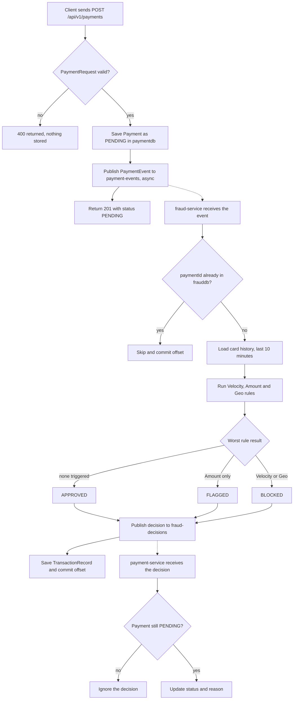
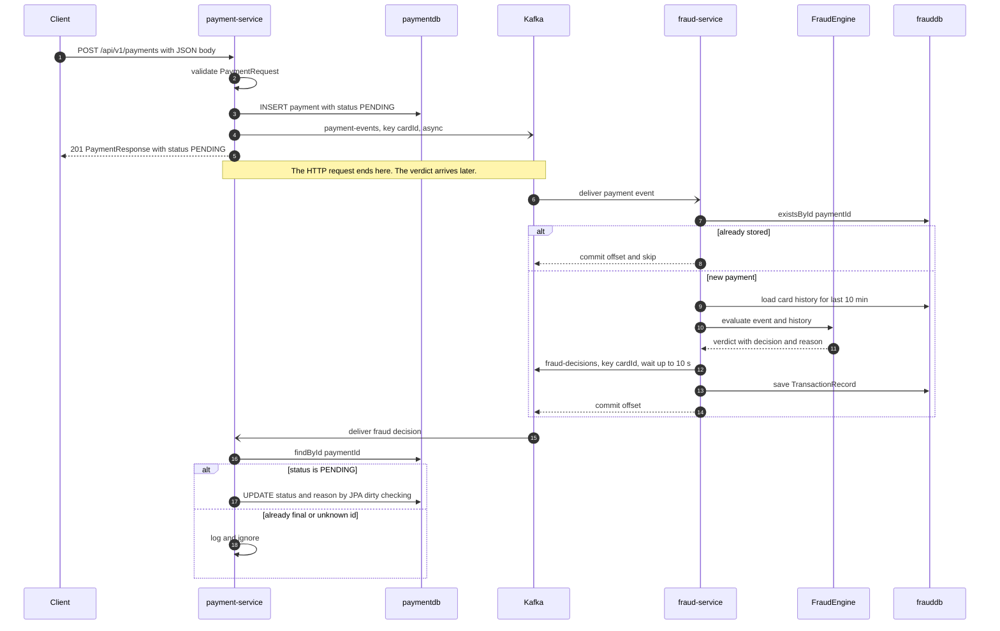
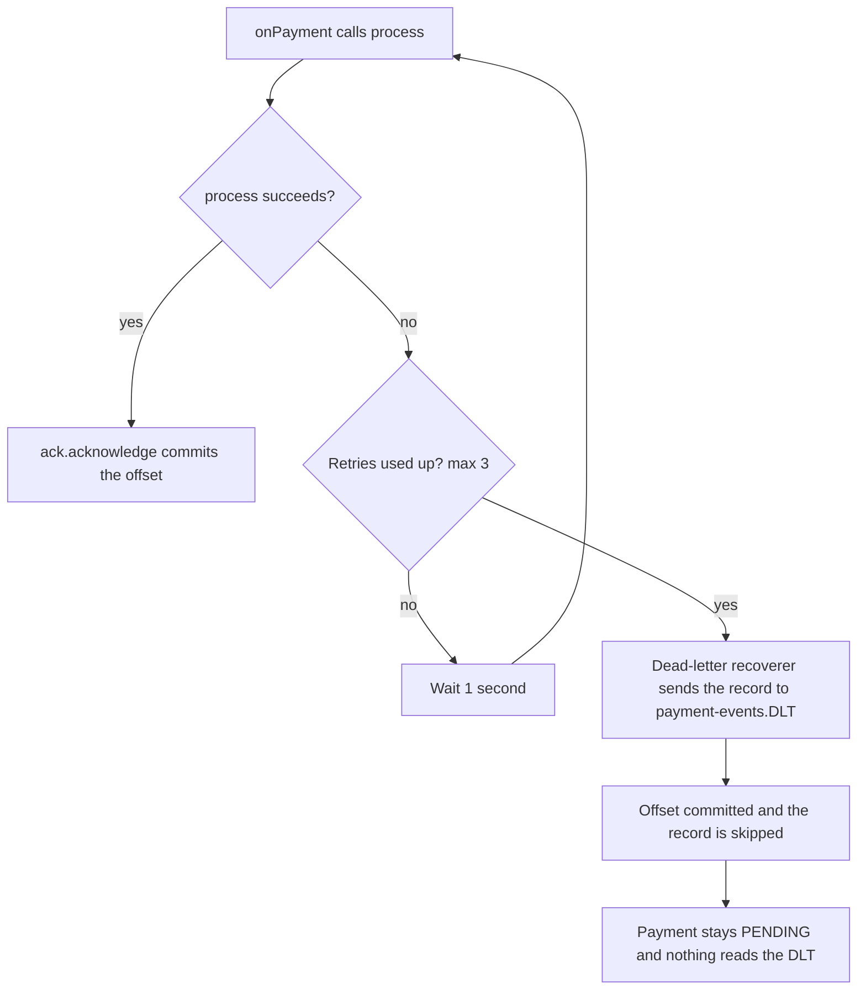
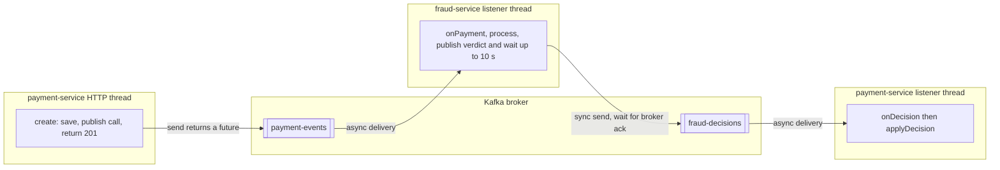

# Workflows

How the system behaves over time, traced through the real code. Read [architecture.md](architecture.md) first for the component map.

**Evidence tags:** `[V]` read in source, `[I]` inferred from framework behavior, `[U]` unverified or unknown, `[T]` a test exists in source.

Path shorthand: `PS` = `payment-service/src/main/java/com/rohan/payment`, `FS` = `fraud-service/src/main/java/com/rohan/fraud`.

## 1. Workflows ranked by importance

| # | Workflow | Why it matters | Covered here |
|---|---|---|---|
| 1 | Place a payment and receive the verdict | The whole product. Touches every component | Fully traced (sections 2 to 6) |
| 2 | Fraud processing fails, is retried, then dead-lettered | The reliability story in interviews | Error-path diagram (section 4) |
| 3 | Duplicate or replayed events | Idempotency in both services | Section 4 table and section 6 |
| 4 | A service is down, then recovers | Why Kafka sits between the services | Section 5 |
| 5 | Read a payment by id (`GET`) | The demo and API reference | Currently broken, see section 7 |

Study workflow 1 first. Workflows 2 to 4 are variations of it.

## 2. Workflow 1: place a payment and receive the verdict

A client posts a payment. The API stores it as `PENDING`, publishes an event, and answers immediately. Later, the fraud service judges it and the verdict updates the stored payment.

Rules in play `[V]`:

| Rule | File | Triggers when | Result |
|---|---|---|---|
| Velocity | `FS/rules/VelocityRule.java` | 3 or more earlier payments from the card in the last 60 s | `BLOCKED` |
| Amount | `FS/rules/AmountRule.java` | amount greater than 100000 | `FLAGGED` |
| Geo mismatch | `FS/rules/GeoMismatchRule.java` | an earlier payment from a different city in the last 10 min | `BLOCKED` |

### Diagram A: end-to-end flow with decisions

Question answered: what are the steps, and where does the path branch?

Dotted arrows cross Kafka, so the receiving step runs later and on another thread.

### Diagram B: sequence over time

Question answered: who talks to whom, in what order?

## 3. Feature-to-file map (every step of workflow 1)

| # | Symbol and file | Trigger and input | Processing and output | State change | Errors and side effects |
|---|---|---|---|---|---|
| 1 | `PaymentController.create` `PS/controller/PaymentController.java` | HTTP `POST /api/v1/payments`, JSON body | Binds JSON to `PaymentRequest`, runs `@Valid`. Calls `PaymentService.create` | none | Invalid body returns `400` `[I]`. Only `@NotNull` is used, so empty strings pass `[V]` |
| 2 | `PaymentService.create` `PS/service/PaymentService.java` | `PaymentRequest` | Builds a `Payment`: id is a random UUID, status `PENDING`, `createdAt` is `Instant.now()`, all set when the object is created in `PS/entity/Payment.java` `[V]`. Calls `repository.save` | `INSERT` into `payments` | The id is preassigned, so `save` probably runs a `SELECT` before the `INSERT` `[I]`. Database error stops the flow before any publish `[I]` |
| 3 | `PaymentEvent.from` `PS/dto/PaymentEvent.java` | saved `Payment` | Copies `paymentId, cardId, amount, merchant, city, createdAt` into a record | none | none |
| 4 | `PaymentEventProducer.publish` `PS/kafka/PaymentEventProducer.java` | `PaymentEvent` | `kafkaTemplate.send("payment-events", cardId, event)`. Returns at once, a callback logs the result | Message appended to the partition chosen by the key `cardId` | A failed send is logged only, not thrown `[V]` |
| 5 | `PaymentResponse.from` `PS/dto/PaymentResponse.java` | saved `Payment` | Returns `201` with status `PENDING` | none | The client never waits for the verdict |
| | *async boundary: Kafka* | | | | |
| 6 | `PaymentEventConsumer.onPayment` `FS/kafka/PaymentEventConsumer.java` | Called by Spring Kafka for each record on `payment-events` (group `fraud-service-group`) | Logs the record, calls `FraudProcessingService.process`, then `ack.acknowledge()` | Offset committed only after `process` returns `[V]` | An exception skips the ack and goes to the error handler (section 4) |
| 7 | `FraudProcessingService.process`, duplicate check `FS/service/FraudProcessingService.java` | `PaymentEvent` | `repository.existsById(paymentId)`. If true: log "Duplicate payment skipped" and return | none | Duplicate events are harmless `[V]` |
| 8 | `FraudProcessingService.process`, demo hook | same | If `fraud.simulate-failure` is true and `merchant` is `SIMULATE_FAILURE`, throw | none | Used only to demonstrate retries and the DLT |
| 9 | `TransactionRepository.findByCardIdAndCreatedAtGreaterThanEqual` `FS/repository/TransactionRepository.java` | `cardId`, `event.createdAt` minus 10 min | Returns this card's recent `TransactionRecord` rows, including earlier blocked ones | none | `SELECT` only |
| 10 | `FraudEngine.evaluate` `FS/engine/FraudEngine.java` | event and history | Runs all rules, drops `APPROVED` results, picks the most severe, joins reasons as `RULE: reason; RULE: reason`. No triggers gives `APPROVED` with "No rules triggered" | none | Pure logic, covered by 12 unit tests `[T]` |
| 11 | `FraudDecisionProducer.publish` `FS/kafka/FraudDecisionProducer.java` | `FraudDecisionEvent(paymentId, cardId, decision, reason, decidedAt)` | `send("fraud-decisions", cardId, event).get(10 s)` | Message appended to `fraud-decisions` | Failure or timeout throws `IllegalStateException`, which triggers retries `[V]` |
| 12 | `TransactionRepository.save` `FS/repository/TransactionRepository.java` | `TransactionRecord` | Stores the verdict | `INSERT` into `transactions` | If this fails after step 11, the retry republishes the verdict, which step 15 ignores `[V]` |
| 13 | `PaymentEventConsumer.onPayment`, ack | `process` returned | `ack.acknowledge()` | Offset committed | none |
| | *async boundary: Kafka* | | | | |
| 14 | `FraudDecisionConsumer.onDecision` `PS/kafka/FraudDecisionConsumer.java` | Called by Spring Kafka for each record on `fraud-decisions` (group `payment-service-group`) | Logs, calls `PaymentService.applyDecision` | none | No explicit ack setting here, see section 7 |
| 15 | `PaymentService.applyDecision` `PS/service/PaymentService.java` | `FraudDecisionEvent` | `@Transactional`. Unknown id: warn and return. Status not `PENDING`: log and return. Otherwise truncate reason to 250 chars, set status from `PaymentStatus.valueOf(decision)` and set reason | `UPDATE payments` when the transaction commits. There is no explicit `save`, so this relies on JPA dirty checking `[I]` | A decision name that is not a `PaymentStatus` throws in `valueOf` `[V]` |

### Worked example (illustrative values, not from a run)

The 4th payment from `CARD-D2` in Pune within 60 seconds, after three earlier ones:

- Step 9 returns 3 records inside the 60 s window.
- Step 10: `VelocityRule` counts 3, which is `>= 3`, so `BLOCKED` with `3 payments in the last 60 seconds`. `AmountRule` and `GeoMismatchRule` pass.
- Verdict reason: `VELOCITY: 3 payments in the last 60 seconds`.
- Step 15 sets the payment to `BLOCKED` with that reason.

A blocked payment is also saved in step 12, so it counts toward later velocity checks. A card stays blocked while attempts keep coming faster than 3 per minute `[V]`.

## 4. Errors, retries and duplicates

### Diagram C: error path in fraud-service

Question answered: what happens when processing a payment event fails?

The settings are in `FS/config/KafkaErrorHandlingConfig.java`: `FixedBackOff(1000L, 3L)` is 1 first attempt plus 3 retries, one second apart `[V]`. That Spring applies this bean to the listener automatically is `[I]`.

### Failure table

| Failure | Result | Evidence |
|---|---|---|
| Invalid request body | `400`, nothing stored or published | `[I]` |
| Database down on `create` | Request fails, nothing published | `[I]` |
| Kafka send fails after the payment was saved | Payment stays `PENDING`. The error is only logged. During Day 2 a `POST` returned `500` while Kafka was down, but the exception was never captured, so the cause is unknown | `[V]` for logging, `[U]` for the `500` |
| fraud-service throws in `process` | Retries, then dead-letter topic (diagram C) | `[V]` config, `[I]` wiring |
| Verdict publish fails | Throws before the save, so the retry starts clean | `[V]` |
| Save fails after the verdict was published | Retry publishes the verdict again. payment-service ignores the second one | `[V]` |
| Duplicate payment event | Skipped in step 7 | `[V]` |
| Duplicate or conflicting decision | Ignored because the payment is no longer `PENDING` | `[V]`, `[T]` |
| Decision for an unknown payment id | Warning logged, skipped | `[V]` |
| Malformed JSON on a topic | `[U]`, will be traced in Phase 4. There is no `ErrorHandlingDeserializer` configured `[V]` |

## 5. Asynchronous execution and recovery

### Diagram D: where the thread and Kafka boundaries are

Question answered: which steps are synchronous, and which wait on Kafka?

- The HTTP response is sent before fraud-service sees the event, so the client always gets `PENDING`. The final status is eventually consistent `[V]`.
- Messages with the same `cardId` land in the same partition, so one card's events are processed in order `[V]`. No listener concurrency is configured, so each listener runs on a single thread `[V]`. That is why the history read in step 9 is consistent without locks.
- Rules compare against the payment's own `createdAt`, not the current time `[V]`. After an outage, queued events are still judged against their original timestamps.
- If fraud-service is down, events wait in `payment-events` and the payment stays `PENDING` until it restarts. If payment-service is down, verdicts wait in `fraud-decisions`. Both follow from Kafka retention and consumer offsets `[I]`. Day 4 scenario D9 in your test document checks the first case.

## 6. Reachability check

Does each important function actually run? A function existing does not prove it executes.

| Function | How it is reached | Status |
|---|---|---|
| `PaymentController.create` | `POST /api/v1/payments` | Reachable `[V]` |
| `PaymentService.create` | Called by `create` | Reachable `[V]` |
| `PaymentEventConsumer.onPayment` | `@KafkaListener` on `payment-events`, invoked by Spring Kafka | Reachable `[I]` |
| `FraudProcessingService.process` | Called by `onPayment` | Reachable `[V]` |
| `VelocityRule`, `AmountRule`, `GeoMismatchRule` | Injected into `FraudEngine` as `List<FraudRule>`, called in `evaluate` | Reachable `[V]` |
| `FraudDecisionProducer.publish` | Called by `process` | Reachable `[V]` |
| `FraudDecisionConsumer.onDecision` | `@KafkaListener` on `fraud-decisions` | Reachable `[I]` |
| `PaymentService.applyDecision` | Called by `onDecision` | Reachable `[V]` |
| `KafkaErrorHandlingConfig.errorHandler` | Used by Spring Kafka when a listener throws | Reachable `[I]` |
| `PaymentController.get`, `PaymentService.get` | `get` is annotated `@GetMapping` without `"/{id}"` in the zip read, so `GET /api/v1/payments/{id}` is not mapped and `get` cannot succeed `[V]` | Not usable until fixed |

## 7. Open items

- **GET by id:** in the zip read, `PS/controller/PaymentController.java` line 24 lacks `"/{id}"`. The owner is applying the fix. Re-verify in Phase 7.
- **Payment-service offset commits `[U]`:** `FS` sets manual acknowledgement, but `payment-service` sets no `enable-auto-commit` or `ack-mode`. Which commit mode is actually used depends on Spring Kafka defaults. To check, start payment-service and search its startup log for `enable.auto.commit` in the `ConsumerConfig values` block. If it is `true`, offsets can be committed before `applyDecision` finishes. Traced in Phase 4.
- **Malformed message behavior `[U]`:** see the failure table. Traced in Phase 4.
- **History has no upper time bound `[V]`:** `findByCardIdAndCreatedAtGreaterThanEqual` returns records newer than the event as well. Per-card ordering makes this rare in normal use. It matters only if events are replayed out of order.

## Verification status

| Claim type | Status |
|---|---|
| Step order, symbols, files, topic names, branches | Read from source `[V]` |
| Spring behavior (validation `400`, error handler wiring, listener invocation, dirty checking) | Inferred `[I]` |
| Runtime behavior | Not executed by the author of this document. Test results come from the project owner |

Next: [code map](code-map.md) and [data flow](data-flow.md).
